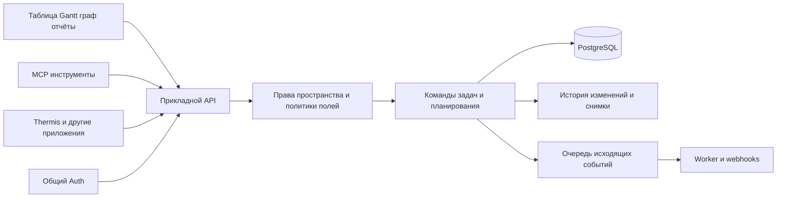

# Простой командный трекер с историей планирования

Исследование и продуктовая спецификация для Павла от 15 октября 2026 года. Перенесено в монорепу Workloom 16 октября 2026 года для подготовки реализации.

Требования описывают командный пилот. Первые локальные версии по уточнению Павла можно делать без входа пользователя. Последовательность подключения Auth и технические решения определяются в [архитектуре](02-architecture.md) и [плане реализации](06-implementation-plan.md).

Предлагаю отдельный продукт в визуальном стиле Thermis: привычная таблица задач, редактируемые поля и представления, наглядные зависимости и автоматически собираемые отчёты. Его основное преимущество для вашей команды — сохранение согласованного плана и объяснение последующих изменений. Простая блокировка Hours Est не решает проблему, когда задачу заменяют, дробят, переносят или добавляют работу после начала недели.

Первый проверяемый результат — команда проводит одну полную рабочую неделю в новом приложении, а руководитель получает воспроизводимый отчёт без ручного сведения таблиц. Это критерий пилота, а не обещание разработать систему за неделю.

Уточнённые условия пилота: 5–7 человек, общие задачи, оценки, факт и отчёты доступны коллегам. Исключение — личные встречи с доступом только выбранным людям. Приоритет — сохранить нынешнюю простоту таблицы, добавить автоматические отчёты, историю выбранных колонок и общие повторяющиеся созвоны. Простая приватность задач и изоляция пространств нужны сразу; расширенный конструктор прав развивается позже.

## Что нужно сохранить из текущей работы

На приложенном скриншоте видны недельные проекты, список с секциями по людям, статусы выполнения, исполнитель, срок, Tags, Hours Est, Hours Fact и Priority. Есть итоговые суммы по секции, пустые значения, задачи с несколькими тегами, а также вкладки других представлений. Наличие вкладки не доказывает, что команда использует её регулярно. Подзадачи и произвольные поля дополнительно требуются из описания процесса. Павел уточнил, что «TPL» было оговоркой: речь о дополнительных кастомных колонках с разными типами значений.

| Текущее поведение | Требование к первому пилоту |
| --- | --- |
| Отдельная таблица недели | Привычный экран недели с архивом прошлых периодов |
| Секции по сотрудникам | Группировка по исполнителю, собственные секции, итоги групп |
| Быстрое редактирование строк | Создание по Enter, перемещение по Tab, вставка нескольких строк, массовое редактирование |
| Задачи и подзадачи | Вложенность, раскрытие дерева, один или несколько исполнителей, сроки и индивидуальный учёт времени |
| Tags и Priority | Множественные теги и настраиваемый single-select для приоритета |
| Hours Est и Hours Fact | Простой ввод часов, история оценок, фактические записи с автором и датой работы |
| Сроки и исполнители | Быстрые фильтры, сохранённые представления и «Мои задачи» |
| Закрытие недели | Снимок плана, фиксация факта, отчёт и прозрачные корректировки |

Комментарии, упоминания, уведомления о назначении и ссылочные/файловые вложения следует включить в сценарий проверки миграции: их использование не видно полностью на скриншоте. Их отсутствие легко заставит команду вести второй список в Asana.

## Что уже предлагает рынок

Возможности ниже сверены с документацией, доступной 15 октября 2026 года. Цены и тарифные ограничения могут меняться. Оценки удобства — качественная интерпретация продукта и отзывов, не измерение долей рынка.

| Продукт | За что его выбирают | Что важно для вашего сценария |
| --- | --- | --- |
| Asana | Понятные задачи, быстрый ввод, совместная работа разных отделов, несколько представлений | Многие нужные элементы уже существуют, но распределены между тарифами и настройками. Важен единый сценарий фиксации недели |
| Jira | Настраиваемые процессы, ограничения переходов, разработка, учёт работы и интеграции | Описанный контроль можно собрать частями, но потребуется администрирование workflow, экранов и отчётности |
| ClickUp | Большой набор возможностей в одной системе | Самый близкий готовый универсальный кандидат; полезен как контрольный пример перед собственной разработкой |
| monday work management | Наглядные таблицы и конструктор процессов | Хороший образец настройки колонок; baseline дат не заменяет историю оценок и состава недели |
| Linear | Быстрый, сдержанный интерфейс для продуктовых команд | Полезен как образец повседневного UX; его Timeline не заменяет Gantt отдельных задач |
| Plane | Настраиваемый трекер с self-hosting и developer API | Кандидат для отдельной оценки расширения существующего продукта; Community и коммерческие возможности нужно различать |
| OpenProject | Планирование и сравнение с прошлым состоянием | Полезный образец исторических представлений, с существенными ограничениями сравнения |

**Asana.** Starter включает custom fields, dashboards, Timeline/Gantt и automations; на странице указано $10.99 за пользователя в месяц при годовой оплате. Advanced — $24.99 при такой же оплате. Это ориентир стоимости подписки, не расчёт экономии от разработки. [Тарифы Asana](https://asana.com/pricing).

Встроенный time tracking доступен начиная с Advanced: оценки, ручной ввод факта/таймер, суммирование подзадач и сравнение оценок с фактом на dashboard. Следовательно, ручное сведение вашей прежней таблицы частично можно устранить уже в Asana. [Time tracking](https://help.asana.com/s/article/time-tracking).

Gantt поддерживает зависимости и baseline для сравнения плана. Документация описывает один baseline на проект с заменой при создании следующего; это не равно долговременному журналу утверждённых недельных обязательств. [Gantt и baseline](https://help.asana.com/s/article/gantt-view).

Ограничение изменения **значений** custom fields есть на Enterprise/Enterprise+. Это отличается от защиты определения поля. Ограничения задаются на уровне проекта; документация отдельно предупреждает о доступе через multi-homing. Также можно ограничить изменения исполнителя и срока. [Ограничения значений полей](https://help.asana.com/s/article/edit-restriction-on-custom-field-values).

У Asana уже есть официальный MCP с чтением, созданием/изменением задач и анализом данных. Поэтому MCP сам по себе не будет уникальным преимуществом нового трекера. [Asana MCP](https://developers.asana.com/docs/using-asanas-mcp-server).

**Jira.** Есть original estimate, remaining estimate, work logs и настраиваемые процессы. Original estimate — название поля, само по себе оно не означает неизменяемый снимок. [Учёт времени](https://support.atlassian.com/jira-software-cloud/docs/log-time-on-an-issue/), [возможности Jira](https://www.atlassian.com/software/jira/features).

Для Jira Cloud company-managed projects Atlassian описывает ограничение Original Estimate через отдельный экран, переход workflow и условие по группе, с удалением поля с обычного edit screen. То есть значительная часть вашего сценария реализуема, но «условно легко» относится скорее к подготовленному администратору. Такой рецепт ещё требует проверки всех используемых каналов записи и правил исторических отчётов. [Официальная настройка ограничения](https://support.atlassian.com/jira/kb/restrict-custom-field-editing-by-user-group/). У Atlassian также есть MCP с OAuth. [Авторизация Atlassian MCP](https://support.atlassian.com/atlassian-ai-gateway/docs/configure-oauth-2-1/).

В опубликованном сравнении G2 Asana получает более высокую оценку простоты использования, а Jira выделяется возможностями процессов и инженерной работы. Это согласуется с вашим опытом, но отзывы — самоотобранная выборка, а не доказательство универсального превосходства. [Сравнение G2](https://learn.g2.com/asana-vs-jira).

**ClickUp.** Предлагает задачи, поля, оценки, time tracking, Gantt, зависимости, dashboards, API, webhooks, MCP и импорт из Asana. [Каталог возможностей](https://clickup.com/features). Детальные права custom fields доступны на Business Plus/Enterprise. [Права полей](https://help.clickup.com/hc/en-us/articles/26025804975895-Custom-Field-permissions). Это близкая готовая альтернатива, но права редактирования ещё не подтверждают нужную вам семантику исходного состава недели, дробления и замены задач.

**monday.** Gantt baseline сохраняет Date/Timeline, позволяя сравнивать исходные и текущие даты; он доступен на Pro/Enterprise. [Baseline](https://support.monday.com/hc/en-us/articles/360020978159-The-Gantt-Baseline). Column restrictions относятся к Enterprise, владельцы доски не ограничены ими. [Permissions](https://support.monday.com/hc/en-us/articles/360019222479-Permissions-on-monday-com). Для нашего продукта полезен UX настройки колонок, а исходные оценки часов нужно моделировать отдельно.

**Linear.** Timeline показывает проекты; отдельные issues в ней не поддерживаются. [Timeline](https://linear.app/docs/timeline). Официальный MCP поддерживает OAuth и отдельный read-only доступ. [MCP](https://linear.app/docs/mcp). Его продуктовая дисциплина — хороший ориентир: сотруднику не нужно видеть весь административный конструктор.

**Plane.** Есть custom properties, оценки, связи/блокировки, подзадачи и time tracking. [Поля задач](https://docs.plane.so/work-items/work-item-properties). Учёт времени документирован как Pro-функция. [Time tracking](https://docs.plane.so/core-concepts/issues/time-tracking). Доступны API, webhooks и MCP, но перед выбором fork/расширения нужно отдельно проверить лицензию конкретной редакции и доступность необходимых функций. [Developer documentation](https://developers.plane.so/).

**OpenProject.** Baseline comparison умеет показывать прошлые значения и изменение попадания задач в выборку. Однако удалённые задачи исключаются из сравнения, а Spent time и Progress не показывают прежние значения. Это наглядный пример того, почему историческая отчётность требует отдельной модели. [Baseline comparison](https://www.openproject.org/docs/user-guide/work-packages/baseline-comparison/).

## Когда собственный продукт оправдан

Если задача сводится к нескольким диаграммам, настройка Asana или проверка ClickUp обычно требует меньше первоначальной работы. Самостоятельный продукт означает постоянную поддержку редактора, прав, импорта, уведомлений, резервных копий и обновлений.

В вашем запросе есть более содержательная причина: единый понятный процесс планирования, собственные правила неизменяемости, гибкие отчёты, программный доступ и связь с портфелем. Под эту цель рекомендую отдельное приложение с узким первым сценарием. Короткая проверка ClickUp и Plane на том же наборе задач полезна как контроль стоимости и объёма собственной разработки; она не должна подменять выбранную вами цель.

Позиционирование для первой команды: «Планируйте как в привычной таблице и сразу видьте зависимости, изменение объёма и результаты недели». Название продукта, коммерческий тариф и публичный запуск сейчас не нужны для архитектурного решения.

## Простой интерфейс и настраиваемое устройство

Основная иерархия: **пространство → проекты → задачи → подзадачи**. Недельный период относится к планированию, а представление — к способу показать задачи. Эти сущности не должны зависеть друг от друга.

Проект существует долго. Период «12–18 октября» выбирает запланированные на неделю задачи. Пользователь видит привычную недельную таблицу, но перенос на следующую неделю сохраняет идентичность задачи и историю. При импорте существующие недельные Asana-проекты сначала сохраняются с их происхождением; объединение в постоянные проекты выполняется по явному mapping, а не по сходству названий.

В пилоте задача принадлежит одному основному проекту и может попадать во множество сохранённых представлений. Полноценный multi-homing с разными политиками проектов лучше отложить. Архитектура может позже поддержать дополнительные связи с проектами, но права и часы не должны дублироваться из-за показа в двух местах.

Сотрудник начинает с «Моих задач» или таблицы недели. Владелец открывает настройки полей, правил и доступа. Готовый шаблон «Недельное планирование по часам» сразу создаёт нужные столбцы и отчёты. Настройки появляются по мере необходимости.

| Настраиваемая часть | Первый набор возможностей |
| --- | --- |
| Поля | Текст, число, длительность, дата, single-select, multi-select, пользователь, checkbox, URL |
| Представления | Видимость, порядок и ширина колонок; сортировка; фильтры; группировка; личные и общие сохранённые виды |
| Статусы | Переименовываемые статусы с системными группами «не начато», «в работе», «завершено», «отменено» |
| Политики полей | Кто изменяет, когда обязательно, когда блокируется, можно ли запросить корректировку |
| Отчёты | Источник, период, метрика, группировка, фильтр, график, выбор исходных или текущих данных |
| Шаблоны | Набор полей, видов, правил и отчётов с версией |

Внутри нельзя привязывать логику к строке «Hours Est». У поля есть стабильный ID, тип и назначение; шаблон связывает выбранное duration-поле с оценкой. Переименование или изменение порядка столбцов ничего не ломает. Типы и option IDs сохраняются в исторических снимках; удаление поля из интерфейса не удаляет его прошлые значения.

У каждой колонки отдельно настраиваются «Вести историю», «Включать в снимок плана» и «Ограничивать изменение». Для оценок история и снимки включены шаблоном; владелец может включить их, например, для приоритета или собственного числового параметра. История начинает накапливаться с включения и не восстанавливает неизвестное прошлое. Отключение истории не удаляет уже записанное; изменения самих политик всегда фиксируются.

Новые типы полей добавляются через внутренний реестр: тип определяет редактор, валидацию, хранение, фильтры и доступные агрегаты. В MVP пользователь создаёт колонки из готовых типов, задаёт варианты и ограничения. Возможность программировать произвольный новый тип внутри интерфейса — отдельный будущий уровень конструктора.

Учёт времени, зависимости и снимки плана всё равно требуют специализированных сущностей. Конструктор настраивает их применение. Попытка выразить весь продукт одной универсальной таблицей усложнит права, отчёты и поддержку.

## Общие задачи и повторяющиеся встречи

Одна задача может иметь нескольких исполнителей. Дополнительно можно указать одного ответственного за результат; у встречи это организатор. Ответственный, участник работы и наблюдатель — разные роли: подписка на обновления сама по себе не начисляет время. Шаблон «Встреча» использует ту же модель задач, добавляя расписание, участие и ссылки на запись/summary. Совместная работа, например парное программирование или ревью, также может иметь нескольких исполнителей без создания копии задачи каждому.

На рынке такой подход встречается: [Asana](https://help.asana.com/s/article/understanding-tasks) допускает одного assignee и нескольких collaborators; назначение копий создаёт отдельные задачи. [ClickUp](https://help.clickup.com/hc/en-us/articles/6309029762583-Multiple-Assignees) поддерживает нескольких assignees и [индивидуальные оценки](https://help.clickup.com/hc/en-us/articles/7255524972055-Set-Time-Estimates-per-assignee). При вводе общей оценки ClickUp описывает её равное распределение между исполнителями. В [monday People column](https://developer.monday.com/api-reference/reference/people) можно выбрать нескольких людей. Само наличие списка участников ещё не означает автоматический учёт присутствия: для нашего сценария требуется явное правило начисления.

### Длительность и время участников

Для часового созвона с пятью участниками плановая длительность — 1 час, плановые трудозатраты — 5 человеко-часов. В личном плане каждому добавляется 1 час. Если все присутствовали полностью, после подтверждения это становится таким же фактом. Общая задача не добавляет шестой час поверх пяти персональных записей.

| Участие в часовом созвоне | Личный факт |
| --- | --- |
| Был весь созвон | 1 час |
| Ушёл через полчаса | 0,5 часа |
| Не участвовал | Подтверждённое отсутствие, 0 часов |
| Присутствие ещё не проверено | Факт не подтверждён |

При трёх полных участниках, одном на полчаса и одном отсутствующем командный факт — 3,5 человеко-часа, хотя встреча длилась час. Длительность встречи, плановые часы участников и сумма факта отображаются с разными названиями. В таблице и графике сроков встреча имеет одну часовую полосу; отчёт о загрузке использует индивидуальные часы.

Режим начисления задаётся шаблоном задачи: у встречи длительность предлагается каждому участнику целиком; у обычной совместной задачи оценки и факт задаются по людям. Простое добавление второго исполнителя к обычной задаче не удваивает её бюджет автоматически. Исходный общий бюджет остаётся, а распределение между людьми задаётся явно; для встречи общий план вычисляется из индивидуальных обязательств.

### Недельный сценарий

1. Организатор один раз создаёт серию «Ежедневный созвон»: дни недели, время, часовой пояс, длительность и участников.
2. На выбранную неделю система создаёт пять самостоятельных датированных задач. Они появляются до фиксации плана, независимо от завершения предыдущего созвона. Серия сама по себе не учитывается как шестая задача.
3. Вверху таблицы находится закреплённая секция «Созвоны». В «Моих задачах» и при группировке по людям отображается та же задача с часами конкретного участника. Закрепление и несколько показов не создают копий данных.
4. После встречи организатор отмечает отсутствующих, при необходимости меняет длительность и нажимает «Учесть время участников». Он может подтвердить весь список одним действием при наличии права вносить факт за участников. Каждому не требуется заводить задачу и повторно вводить один и тот же час.
5. Участник видит начисленный ему факт и может исправить длительность в рамках политики периода. Видно, кто внёс и кто исправил данные. Приглашение и наступление времени встречи сами по себе не создают подтверждённый факт.

Удаление отсутствующего из конкретного созвона в интерфейсе означает снятие участия/отметку отсутствия. После фиксации недели первоначальный состав приглашённых и их плановые часы остаются в baseline. Удаление человека из серии влияет на будущие встречи, а не стирает старые часы. Уже подтверждённый факт отменяется только явной корректировкой.

Повторное нажатие, retry API или MCP не создают повторных начислений. Запись участия уникальна по паре «экземпляр встречи + человек»; создаваемая из неё запись времени имеет постоянный источник. Ручная правка тех же часов изменяет её версию. Отдельную подготовку к встрече можно учитывать дополнительной явно обозначенной записью.

### Повторения и материалы

Для MVP достаточно ежедневного/еженедельного расписания с выбранными днями, даты окончания или числа повторений, пропуска и переноса отдельной встречи. Действия изменения различаются: «Только эта встреча» и «Эта и будущие». Прошедшие экземпляры и зафиксированные обязательства не пересоздаются; изменения уже зафиксированного будущего плана отражаются как поправки.

Серия и каждый экземпляр имеют стабильный ID. Перенос сохраняет ID экземпляра, а повторная генерация недели не создаёт дубликатов. Расписание учитывает часовой пояс и переходы летнего времени. При переносе на следующую неделю исходный план остаётся в первой, факт относится к дате проведения. Отменённая встреча сохраняется с отметкой отмены и не начисляет время.

Ссылка на видеозапись и ссылка/текст summary относятся к конкретной встрече. Постоянная ссылка для подключения может храниться в серии; запись вчерашнего созвона не копируется в завтрашний. На первом этапе достаточно URL и заметок, без собственной записи видео или транскрибации.

Приватная встреча видна только организатору и явно допущенным людям. Права на просмотр не следует смешивать с фактом присутствия: наблюдатель может иметь доступ к материалам без начисления часов. Удаление из участников и отзыв доступа — отдельные действия, чтобы отсутствие на встрече не стирало историю и не меняло доступ неожиданно. Закреплённая карточка и материалы подчиняются тем же правилам видимости.

## Как сохранить первоначальную оценку

Нужны три разные величины:

1. **Исходная оценка всей работы** — первое согласованное обязательство по задаче или пакету связанных работ.
2. **План на период** — какой объём часов и какие результаты команда запланировала именно на эту неделю.
3. **Факт** — записи работы с длительностью, днём или неделей выполнения и человеком, который работал.

Дополнительно хранится текущий прогноз остатка. Он может меняться и помогает планировать, но не заменяет исходную оценку.

В шаблоне недельной таблицы Hours Est означает план часов на выбранный период. Оценка всей задачи доступна в карточке; для обычной задачи на одну неделю эти значения могут совпадать. Поля уровня задачи и уровня периода имеют явную область действия, чтобы изменение плана следующей недели не переписало предыдущую.

Обычная новая задача недели требует только одного ввода Hours Est: он по умолчанию задаёт и полную оценку, и недельный план. Отдельное распределение открывается при многонедельной задаче или переносе. Внутренняя точность модели не должна заставлять команду заполнять три колонки вместо одной.

Например, вся задача оценена в 20 часов, на эту неделю запланировано 6. Для загрузки недели сравниваются 6 часов с работой этой недели. Для точности общей оценки после завершения сравниваются 20 часов со всем фактом задачи. Сопоставлять недельный факт с полной оценкой неверно.

Для незавершённой задачи итоговый прогноз равен накопленному факту плюс прогнозу остатка. Сам по себе факт ниже исходной оценки ещё не означает экономию времени.

### Фиксация плана

Период проходит состояния «Планирование → План зафиксирован → Факт закрыт». Пользователь может раньше нажать «Зафиксировать мой план», а владелец — зафиксировать весь проект либо настроить время автоматической фиксации.

Снимок сохраняет точный набор задач/пакетов работ, оценки, недельные обязательства, исполнителей, категории, сроки и выбранные дополнительные поля. Для общих задач и встреч сохраняются состав участников и индивидуальные плановые часы. Также сохраняются структура, автор фиксации, время, часовой пояс, версия политики и определения полей. Пустое значение сохраняется как отсутствующее, а не превращается в ноль.

Личная фиксация относится к конкретным записям и их версиям. Простая смена исполнителя не должна снять замок. Добавленная после фиксации задача получает отметку «Добавлено после плана» и собственную первую оценку; она не включается задним числом в исходное обязательство.

Снимки доступны только для добавления новых версий. Даже владелец не переписывает исходный снимок: он создаёт корректировку с причиной. Отчёт показывает первоначальную и исправленную версии, а закрытый отчёт не меняется незаметно.

### Изменение и дробление задач

| Событие | Поведение системы |
| --- | --- |
| Полную оценку 8 часов хотят заменить на 12 | Исходные 8 остаются; новый прогноз всего — 12. Если уже потрачено 5, прогноз остатка — 7. Изменение видно в истории |
| Задачу разбили на две подзадачи | Создаётся связь с исходным пакетом работ; старый бюджет не копируется в каждую дочернюю задачу |
| Задачу заменили новой | Операция «Заменить» связывает старую и новую; старое обязательство остаётся в отчёте |
| Добавили новую работу | Отдельное добавление объёма с причиной; baseline не меняется |
| Задачу отменили или архивировали | Она остаётся в исходном плане с результатом «отменена/снята» |
| Перенесли на следующую неделю | Сохраняется task ID; создаётся новое недельное обязательство по оставшейся работе |
| Поменяли исполнителя или категорию | Отчёт может показать исходное назначение и текущее; фактические часы принадлежат выполнившему работу |
| Исправили факт после закрытия недели | Новая ревизия/корректировка с причиной, без скрытой перезаписи закрытого отчёта |

Пример: исходный пакет оценён в 8 часов, затем разбит на части. На первую ушло 3 часа, на вторую — 7. Общий факт — 10, отклонение от исходной оценки — +2 часа, или +25%. Новые оценки дочерних задач не обнуляют эти 8 часов. Если дополнительно попросили отдельную функцию на 5 часов, она отражается как добавленный объём; её фактическое выполнение учитывается отдельно от первоначального состава.

При дроблении нужно различать «детализация прежней работы» и «новый объём». Бюджет распределяется или остаётся на исходном пакете, но никогда не суммируется и у родителя, и у детей. Каждый worklog считается один раз; работа, записанная на родителя до дробления, остаётся в общем факте пакета.

Полный произвольный merge нескольких пакетов в MVP не нужен: он требует правил распределения факта. Достаточно split, replace и явного добавления объёма. При переносе потомка между родителями его происхождение не теряется.

Система может сделать изменения видимыми, но не может достоверно определить, что новая несвязанная задача на самом деле является переименованной старой. После фиксации любое добавление видно; дальнейшую классификацию подтверждает человек. Самооценка фактически потраченных часов тоже не становится объективным измерением только из-за наличия журнала.

### Простой ввод факта

В таблице остаётся привычная ячейка Hours Fact. Внутри она представляет сумму записей работы, а не бесследно перезаписываемое число. Ввод сотрудником «итого 5 часов за эту неделю» создаёт или корректирует его собственную запись с точностью до недели. При желании можно выбрать конкретный день. Недельную сумму нельзя автоматически распределять по дням или выдавать за точный дневной факт; при фильтре на часть недели она показывается как нераспределённая. Общая сумма по нескольким людям открывает детализацию и не позволяет случайно заменить чужое время.

Запись содержит человека, день или период работы с указанием точности, время внесения, длительность, задачу, категорию работы и автора ввода. Исправления версионируются. Внесённая задним числом работа после закрытия периода становится поправкой к нему. Время хранится в целых минутах или секундах, в интерфейсе — в часах. Таймер можно добавить позже; для миграции важнее быстрый ручной ввод.

## Настраиваемые блокировки и правила

Первый конструктор: **когда → для каких записей → какое действие**. Пользователь выбирает варианты из форм, а не пишет код.

| Когда | Условие | Действие |
| --- | --- | --- |
| Наступил понедельник 10:00 в часовом поясе пространства | Проект использует недельное планирование | Зафиксировать период и выбранные поля |
| Участник нажал «Мой план готов» | Его набор задач в текущем периоде | Зафиксировать личный план |
| Задачу переводят в Done | Требуется учёт часов | Запросить факт или явное «0, работа не требовалась» |
| Создали задачу после фиксации | Она включена в текущую неделю | Пометить как добавленную после плана |
| Владелец закрыл неделю | Проверены незаполненные данные | Зафиксировать факт и версию отчёта |

На первом этапе нужны ограниченные события, простые AND-условия и проверенные действия. Произвольные скрипты, циклы, marketplace модулей и сложная графическая workflow-среда могут появиться позже.

Правила исполняются на сервере одинаково для UI, REST, MCP, импорта и фоновых операций. Изменение конфигурации правила после фиксации не меняет прежний snapshot.

Для автоматического cutoff нельзя рассчитывать только на своевременность cron. Все команды, меняющие затронутый план, сериализуются через период: при достижении cutoff сначала атомарно фиксируют ещё не зафиксированный план и лишь затем применяют разрешённое изменение как последующее. Фоновый worker выполняет тот же идемпотентный переход. Это закрывает гонку между редактированием и отложенным запуском job; потребуется проверить стоимость такого барьера на ожидаемой нагрузке. Интерфейс блокирует редактирование по серверной политике, а не по часам браузера.

## Представления и диаграммы

**Таблица** — основной рабочий экран. Фиксированное имя задачи, быстрое редактирование, секции, суммы, дерево подзадач, перетаскивание, сохранённые фильтры и боковая карточка задачи. Владелец выбирает столбцы; личный вид не меняет общий.

**Gantt** отвечает на вопрос «когда и в каком порядке». Для MVP: начало/конец, зависимости finish-to-start, drag дат с проверкой прав, подсветка конфликтов, сравнение с зафиксированными датами. Задачи без дат находятся в отдельной области «Не запланировано». Оценка в 8 часов не означает автоматически календарную длительность в один день. Автоматический сдвиг всей цепочки, календари загрузки и другие типы зависимостей — следующий этап.

**Граф зависимостей** отвечает на вопрос «что что блокирует». Карточки задач и стрелки, автоматическая раскладка, ручная расстановка с сохранением позиций, создание связи перетаскиванием, фильтр по человеку/проекту и фокус на соседях выбранной задачи. Связи «блокирует», «подзадача» и «заменяет» имеют разный смысл и оформление.

Циклические блокировки запрещаются. Если блокирующая задача скрыта фильтром, виден индикатор внешнего препятствия; если скрыта правами — нейтральное сообщение без раскрытия названия. Настройка обязательности блокировки может запрещать старт или только предупреждать. В MVP достаточно одного понятного режима на проект.

**Отчёты** — bar chart, stacked bar, line и таблица с переходом к исходным строкам. Kanban можно добавить следующим небольшим представлением; календарь и resource planning не являются условием первого недельного пилота, если команда не подтвердит их ежедневную необходимость.

## Отчёты без ручного сведения

Первый набор шаблонов на общем конструкторе:

1. План часов и факт недели по людям, отдельно запланированная и добавленная работа.
2. Отклонение исходной оценки для завершённых сопоставимых пакетов работ.
3. Куда ушло время: bugs, core feature, side feature, business feature, support, management и другое.
4. Что изменилось после фиксации: добавлено, отменено, перенесено, изменён прогноз.
5. Блокировки и просрочки, с переходом к зависимостям.
6. Качество данных: нет оценки, нет факта, нет категории, неоднозначный импорт.

Каждый шаблон — сохранённая настройка источника, периода, метрики, группировки и фильтра. Можно выбрать любого доступного человека, проект или custom field. В MVP используются разрешённые агрегаты и ограниченные формулы с проверкой типов; произвольный SQL/JavaScript через UI или MCP не нужен.

Показатели должны иметь точное определение:

- Отклонение завершённой исходной работы: `факт исходного объёма − исходная оценка`; процент — деление на исходную оценку, только если она больше нуля.
- Точность оценок считается на сопоставимом наборе завершённых пакетов, с числом наблюдений и долей покрытого плана. Незавершённые задачи показываются отдельно.
- Факт недели определяется днём выполнения worklog или явно указанной неделей работы, а не датой закрытия задачи. Учитываются часовой пояс периода и точность записи; недельный агрегат не превращается в дневные значения.
- Доля типа работы: `фактические часы типа / все учтённые часы выбранного периода`. «Без категории» входит в знаменатель и виден отдельно.
- Для аддитивных долей используется одно основное поле «Тип работы». Свободные Tags остаются множественными фильтрами; если строить по ним график, он явно помечается как пересекающийся и может превышать 100%.
- Категория фактической работы фиксируется в записи/её версии, первоначальная категория — в baseline. Переклассификация не переписывает прошлые закрытые отчёты.
- В отчёте по людям различаются первоначальный ответственный и человек, выполнивший работу. Автор ввода — отдельный участник audit: менеджер может внести чужие часы, но они не становятся его работой. Ответственный задачи не получает автоматически все часы коллег.
- Пустой факт означает «не внесён», а ноль — явное подтверждение нулевой работы. Деление на ноль возвращает «нет применимого процента».

Рейтинг сотрудников по одному проценту попадания в оценку не предлагается. Поддержка, неопределённость задачи, ревью и изменение требований влияют на эти числа. Основное назначение отчёта — улучшать планирование и показывать структуру работы.

Закрытый отчёт хранит baseline ID, версию метрик и фильтров, cutoff факта и ревизию данных. После исправлений можно открыть исходный отчёт и пересчитанную версию. Иначе автоматический отчёт останется столь же подвижным, как редактируемая таблица.

## Пространства и права

Каждый пользователь может создать пространство и состоять в нескольких. Данные принадлежат пространству; один пользователь в одном месте может быть владельцем, в другом — обычным участником.

Начальные пресеты: Owner, Admin, Member, Viewer. В пилоте все 5–7 участников видят общие задачи пространства; владелец управляет приглашениями, настройками фиксации и корректировками. Для личных встреч уже в MVP нужна видимость задачи «Общая» или «Только выбранные люди». Настраиваемый редактор ролей и ограничения отдельных проектов относятся к развитию после пилота. Модель возможностей сразу различает просмотр, изменение задач, ввод своего/чужого факта, управление полями, правилами, baseline, отчётами и приглашениями.

В пилоте участники видят часы и отчёты коллег по общим задачам, как сейчас в Asana. Приватные встречи исключаются из чужой выборки до расчёта сумм, графиков и экспорта. Отчёт обозначается как отчёт по доступным данным; он не раскрывает число скрытых встреч. Участник видит собственное время, а при последующем отзыве доступа к карточке его запись может показываться без названия и ссылок. Передача руководителю отдельного агрегата «Личные встречи» потребует явной политики и не включается по умолчанию. Владение пространством само по себе не даёт чтения деталей приватной встречи.

Ограничения действуют в поиске, уведомлениях, закреплённых секциях, графе зависимостей, API, MCP и исторических отчётах. Новые участники серии не получают автоматически доступ к старым приватным экземплярам. Ссылка и summary скрываются вместе с карточкой, но доступ по самому внешнему URL управляется сервисом записи. Скрытый столбец в представлении не является ограничением доступа.

Право изменить поле определяется пересечением доступа к пространству/проекту, capability, области действия записи и политики блокировки. Owner имеет право оформить исключение с причиной; он не получает обычную кнопку бесследно переписать snapshot.

Приглашения одноразовые либо явно ограниченные, со сроком, отзывом и назначаемой ролью. Сопоставление приглашения с личностью должно учитывать доказательство владения email, а не только совпадение строки. Удаление человека из пространства немедленно прекращает доступ, включая его API/MCP credentials.

## Что использовать из Thermis и Auth

Репозитории исследованы чтением исходников и документов; это подтверждение локальной реализации, не проверка актуального production UI или авторизованных сценариев.

| Компонент | Что есть сейчас | Решение для нового трекера |
| --- | --- | --- |
| Thermis UI | React 19, Vite, Tailwind 4, Inter, indigo, светлый slate, белые панели | Взять токены и визуальные/поведенческие образцы |
| Thermis CRM | Inline table, column chooser, custom fields, filters, ReportBuilder/Recharts | Адаптировать редакторы и UX; task hierarchy и исторические отчёты реализовать отдельно |
| Thermis backend | Fastify, TypeScript, PostgreSQL/Drizzle, BullMQ/Redis | Знакомый стек для отдельного модульного приложения |
| Thermis tenancy | Teams, memberships, invites; фиксированные admin/member/viewer | Использовать опыт, но создать capability-политику для нового домена |
| Thermis MCP | stdio/HTTP, обращения через общий API | Сохранить единый путь команд и добавить scoped credentials/единые проверки |
| Общий Auth | Google login, RS256 JWT/JWKS, стабильный user UUID, refresh | Использовать для идентификации и входа |
| Workspace/RBAC | В общем Auth нет модели пространств и проектных прав | Хранить в новом продукте |
| Remote MCP OAuth | Auth не предоставляет code+PKCE/discovery | Отдельная задача для стандартизированного внешнего MCP |

Исходники Thermis: [токены](../../hunter-linkedin/client/src/index.css), [оболочка](../../hunter-linkedin/client/src/components/layout/AppLayout.tsx), [таблица](../../hunter-linkedin/client/src/components/crm/EntityTable.tsx), [ReportBuilder](../../hunter-linkedin/client/src/components/crm/ReportBuilder.tsx), [поля](../../hunter-linkedin/src/db/schema/crm.ts), [членства и приглашения](../../hunter-linkedin/src/db/schema/users.ts), [MCP API client](../../hunter-linkedin/src/mcp/api-client.ts).

Существенное уточнение: Thermis сейчас содержит собственную password/JWT и Google/LinkedIn авторизацию. Найденная связь с общим Auth относится к analytics. Поэтому новый трекер подключается к общему Auth отдельно, а не копирует якобы готовый общий login из CRM. [Thermis auth](../../hunter-linkedin/src/modules/users/auth.ts), [analytics runtime](../../hunter-linkedin/client/src/lib/analytics-runtime.ts).

Для браузера предлагается backend-сессия с HttpOnly cookie и серверным обновлением refresh. В документации Auth есть этот BFF-паттерн и предупреждение о гонке refresh в нескольких вкладках. Роли и tenant context проверяются самим трекером при каждом запросе. [Auth integration](../../auth/docs/INTEGRATION.md), [JWT](../../auth/src/services/token.service.ts), [email trust](../../auth/docs/VERIFIED_EMAIL.md).

Не стоит переносить permission-слой Thermis как готовый: роли фиксированы, у API keys нет scopes, а некоторые пути проверки membership различаются. Это основание проектировать единый контроль доступа, а не заключение о проверенном production-инциденте. Внутренний EventEmitter Thermis также не обеспечивает доставку межпродуктовых webhooks. [Проверки auth](../../hunter-linkedin/src/modules/users/auth.ts), [ModuleBus](../../hunter-linkedin/src/core/module-bus.ts).

## Архитектура для MVP и роста

Отдельный репозиторий, база данных и deployment. Frontend React/Vite с визуальным языком Thermis; backend TypeScript/Fastify; PostgreSQL; worker для расписаний, импорта, отчётов и доставки событий. Уточнение плана от 16 октября: для пилота выбран pg-boss поверх PostgreSQL без отдельного Redis; детали в [архитектуре](02-architecture.md). BullMQ/Redis остаётся наблюдением о существующем Thermis, а не требованием нового продукта.

Один модульный backend проще развивать на старте. Разделение внутри: identity adapter, spaces/access, projects/tasks, fields/views, planning/baselines, worklogs, dependencies, reports, automation, integrations. Выделять микросервисы до появления измеренной необходимости не требуется.

Основные сущности: Workspace, Membership, Invitation, Role/Capability, Project, Section, Task, TaskParticipant, TaskAccessGrant, RecurrenceSeries/Exception, FieldDefinition/Value, SavedView, PlanningPeriod, PeriodCommitment, Baseline/Item, WorkPackage/Lineage, WorkLog/Revision, Dependency, FieldPolicy, AutomationRule, AuditEvent, ReportDefinition/Run, ExternalLink и OutboxEvent. Экземпляр повторяющейся встречи — обычная Task со ссылкой на серию и стабильным occurrence key; TaskParticipant хранит роль участия, личный план и подтверждение присутствия, а WorkLog — фактические часы.

Core-поля хранятся в типизированных колонках. Для custom fields — типизированные definitions и валидируемые значения; конкретный выбор JSONB или отдельных indexed value tables уточняется по запросам отчётов. Hours Fact вычисляется из worklogs. Исторические поля и snapshot не зависят от текущего имени колонки.

Каждая запись данных несёт workspace ID. Ограничения связей не дают соединить задачу одного tenant с проектом другого; серверный authorization общий для всех каналов. PostgreSQL RLS может служить дополнительной защитой при выбранной модели соединений, но не заменяет прикладные проверки.

Все значимые изменения сохраняют actor, источник UI/API/MCP/import, серверное время, старое/новое значение, причину, версию записи и request ID. Текущее состояние, audit и outbox записываются одной транзакцией. Достаточно обычных таблиц, версий и append-only истории; полный event sourcing для MVP не нужен.

Нужны optimistic concurrency и защита от повторного запроса. Пользователь видит конфликт двух правок вместо тихой потери одной из них. Снимки и журнал защищены от обычного изменения приложением; это не обещание криптографической неизменяемости перед администратором базы.

Схема базы развивается через версионированные миграции. Резервные копии должны иметь проверенное восстановление: сохранность исторических планов является частью функциональности продукта.

## MCP API и связь с Thermis

API проектируется с первого дня. UI, интеграции и MCP вызывают одни прикладные команды. У MCP нет отдельного обхода прав, блокировок и правил обязательных полей.

Первый набор инструментов: список пространств/проектов, поиск и чтение задач, создание/изменение задачи, добавление подзадачи, управление зависимостями, чтение определения полей, запрос отчёта, чтение baseline. Для общих встреч нужны команды создания серии, изменения одного экземпляра и подтверждения участия с индивидуальным временем. Отдельные разрешения нужны на запись своего/чужого времени, фиксацию периода, корректировки и управление правилами. Приватность задач и защита от повторного начисления одинаковы для UI и MCP. Имя инструмента в этом документе — концепция, не готовый опубликованный контракт.

Внутренний MCP-пилот возможен через stdio и ограниченный отзывной credential, привязанный к пользователю, пространству и scopes. Credential не является общим Auth JWT и не даёт больше прав, чем текущее членство.

Для внешнего HTTP MCP потребуется полноценный authorization flow: discovery, OAuth authorization code с PKCE, consent/scopes, resource-bound tokens и отзыв. Auth прямо документирует отсутствие code+PKCE/discovery. Нельзя выдать общий токен `aud=pet-projects` внешнему агенту и считать делегирование готовым. [Контракт Auth](../../auth/docs/INTEGRATION.md), [спецификация MCP authorization](https://modelcontextprotocol.io/specification/2025-11-25/basic/authorization).

Для чувствительных массовых операций удобно предусмотреть prepare/apply: сначала возвращается список изменений и версия, затем применение с соответствующими правами. Обычное редактирование одной доступной задачи не требует дополнительной церемонии.

Первый будущий сценарий Thermis: из сделки/контакта создать задачу и получить обратную ссылку; по завершении задачи добавить событие в карточку CRM. Для этого нужны согласованная связь пространств и ExternalLink с IDs обоих продуктов. Совпадение user ID или email не означает автоматического совпадения рабочих пространств.

Webhooks: versioned event, HMAC, retries, idempotency, журнал доставки, минимально необходимые данные. Транзакционный outbox исключает потерю события между сохранением задачи и отправкой. На первом этапе один продукт владеет изменяемыми полями, другой отображает ссылку/событие; полноценная двусторонняя синхронизация добавляет конфликты и циклы.

## Границы первой версии

| Обязательная часть для недельного перехода | Что принимается как готовое |
| --- | --- |
| Общий вход и пространства | Создание пространства, приглашение, роли, смена/отзыв доступа |
| Рабочая таблица | Задачи, подзадачи, секции, несколько исполнителей, даты, теги, priority, поля, суммы, массовые операции |
| Совместная работа | Карточка, комментарии, упоминания, уведомления и необходимые вложения |
| Общие созвоны | Повторения по дням недели, отдельные экземпляры, закреплённая секция, участники, индивидуальное время, отсутствие/частичное участие, запись и summary по ссылке |
| Личные встречи | Явный список доступа, фильтрация приватных данных во всех представлениях и отчётах |
| Планирование | Периоды, исходная оценка, личная/общая фиксация, автоматический cutoff, добавленный объём, переносы |
| Факт и история | Ручной ввод, worklogs, исправления, закрытие недели, audit |
| Визуализация | Простой Gantt и граф зависимостей на тех же задачах |
| Отчёты | Готовые шаблоны, выбор метрик/группировок/фильтров, drill-down, экспорт |
| Настройка | Типизированные поля, выбор истории/фиксации колонок, несколько правил, сохранённые виды и пресеты ролей |
| Перенос данных | Preview импорта, mapping, повтор без дублей, сверка и экспорт на выход |
| Программный доступ | Общий API, scoped credentials, небольшой внутренний MCP-пилот |

Это уже существенный продукт. Реализовывать его стоит вертикальными шагами: сначала локальная оболочка и таблица без входа на синтетических данных; затем замкнутый цикл фиксации/факта/отчёта, повторяющиеся встречи, зависимости и представления; общий вход подключается перед командным недельным пилотом. Точная последовательность уточнена в [плане реализации](06-implementation-plan.md). Технические инварианты tenant isolation, audit и общей команды записи нужны с первого шага.

Следующий этап: Kanban/Calendar, таймер, расширенные формулы, редактор ролей и видимости, workload/capacity, дополнительные типы зависимостей, автоматическое перепланирование с preview, remote OAuth MCP, первый Thermis webhook и более сложные workflow. Объём каждого шага оценивается после согласования поведения; сейчас нет основания обещать календарный срок разработки.

Calendar здесь — представление собственных данных Workloom. Подключение личных Google Calendar/Microsoft Outlook — отдельная будущая функция после первого пилота, а не требование пилота и не реализованная возможность. Её проектные границы описаны в [10](10-calendar-integration.md).

## Переход из Asana

Asana поддерживает экспорт JSON/CSV. [Экспорт проектов](https://help.asana.com/s/article/project-importing-and-exporting?language=en_US). Для отношений и дополнительных сущностей есть отдельные API: [задачи проекта](https://developers.asana.com/reference/gettasksforproject), [подзадачи](https://developers.asana.com/reference/getsubtasksfortask), [stories](https://developers.asana.com/reference/getstoriesfortask). Полноту конкретного экспорта нужно проверять на реальном проекте.

1. Получить экспорт одной типичной недели и связанных задач. Выполнить preview mapping пользователей, полей, категорий, статусов и дат без переключения команды.
2. Сохранять Asana GID и source URL; повторный импорт обновляет соответствующую запись, а не создаёт копию. Подзадачи обходятся отдельно/рекурсивно по API, если экспорт их не покрывает.
3. Сверить количество задач/подзадач, связи, сроки, исполнителей, значения полей, суммы, комментарии и доступность вложений. Неизвестного пользователя оставить явно несопоставленным; не назначать его часы импортировавшему администратору.
4. Не считать перенесённый текущий Hours Est доказательством первоначальной оценки. Старые оценки/факт получают происхождение «Импортировано». Если нет полной истории или даты факта, не включать их в точную недельную ретроспективу.
5. Для первого пилота перенести активную и следующую недели, незавершённые задачи и их необходимые зависимости. Asana остаётся историческим архивом; массовое восстановление всех старых недель не является обязательным условием старта.
6. На согласованном cutoff переключить пилотный объём на один источник записи. Сохранить исходный экспорт, контрольные суммы и возможность выгрузить новые изменения обратно. Не удалять Asana-проекты.
7. Через неделю сопоставить новый отчёт с небольшой ручной контрольной выборкой и собрать замечания команды.

Импорт должен соблюдать rate limits, pagination и Retry-After. [Asana API rate limits](https://developers.asana.com/jd/docs/rate-limits). Полная двусторонняя синхронизация в MVP не нужна: она создаёт спор о том, какая система определяет блокировки и историю.

## Критерии принятия пилота

- Команда выполняет повседневные действия без возврата к Asana для пилотного объёма.
- Сверка импорта не содержит необъяснённых потерь или дублей; исключения перечислены.
- Переименование, split, replace, reassignment, перенос и архивирование не стирают исходный план и не удваивают часы.
- Недельный факт и точность полной оценки используют разные, корректные временные выборки; пропуски и нули различаются.
- Часовой созвон пяти присутствовавших даёт каждому 1 час, команде 5 человеко-часов и остаётся одной часовой встречей. Частичное участие и отсутствие меняют индивидуальный факт; повторное сохранение/MCP не удваивает его.
- Пять будних созвонов создаются до фиксации недели. Перенос/отмена одного экземпляра и изменение будущей серии не переписывают прошлые записи, ссылки и baseline.
- Приватная встреча, её название, запись, summary, участники и часы не попадают в чужие карточки, поиск, закрепления, уведомления, MCP, экспорт или неразрешённые агрегаты.
- После cutoff защищённые значения нельзя изменить через UI, API, MCP, импорт или отложенную job; исправление создаёт новую версию.
- Пользователь другого workspace не читает и не изменяет задачи, файлы, поиск, отчёты или события. Отзыв membership прекращает доступ старого credential.
- Gantt и граф показывают один набор зависимостей; циклы отклоняются; фильтр не скрывает сам факт блокировки и не раскрывает чужие данные.
- Отчёт раскрывается до исходных задач/записей, объясняет добавленный объём и воспроизводится после закрытия недели.
- Проверены одновременные правки, повтор запросов, несколько вкладок с refresh и восстановление резервной копии.
- Производительность измерена на согласованном размере команды/проекта; целевое число строк и p95 следует определить до планирования работ, а не объявлять масштабируемость без замера.

Подтверждено Павлом: 5–7 человек в первой команде, кастомные колонки, общая видимость обычных задач и отчётов, автоматические отчёты и логи выбранных параметров. Дополнительно нужны общие повторяющиеся созвоны с несколькими участниками, начислением времени каждому, ссылками на запись/summary, закреплением сверху и приватностью отдельных личных встреч. Для планирования разработки остаются объём активных задач, обязательные комментарии/файловые вложения, сложность подзадач и порядок утверждения исключений. Структура рассчитана на одну пилотную команду при архитектурной изоляции нескольких пространств. Продуктовые решения и roadmap портфеля этим предложением ещё не изменены.
