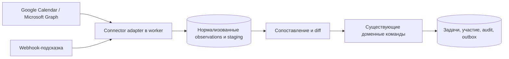

# Будущее подключение внешних календарей

Проектная заметка от 16 октября 2026 года. Статус: будущий дизайн, ничего не реализовано. Работа рассматривается только после первого недельного пилота P6 и выбирается по его результатам. Она не является зависимостью P0–P6, не входит в P3 и не меняет критерии пилота. Продуктовые требования остаются в [01](01-product-spec.md), доменные правила — в [03](03-domain-and-data.md), общие команды и outbox — в [04](04-api-and-integrations.md), этапность — в [06](06-implementation-plan.md).

## 1. Две разные функции

| Функция | Что это | Связь с внешними сервисами |
| --- | --- | --- |
| Календарное представление Workloom | Ещё один вид собственных задач, встреч и сроков Workloom, как таблица или Gantt | Нет. Читает только данные Workloom через обычные queries и ACL |
| Подключение личного внешнего календаря | Индивидуальный connector к Google Calendar или Microsoft Outlook, который предлагает прогноз занятости и встречи | Да. OAuth, синхронизация, staging и сверка |

Функции независимы: календарный вид не требует connector, а connector не требует календарного вида. Ниже описано только подключение внешних календарей.

## 2. Границы первой версии connector

- Подключение делает отдельный участник для себя: opt-in, привязка к его membership в конкретном workspace. Администратор не подключает чужой календарь.
- Пользователь выбирает allowlist календарей, фильтр событий и горизонт времени. Без выбора ничего не читается.
- Доступ к провайдеру только на чтение. Нет записи событий, приглашений, ответов на приглашения и автоматической обратной синхронизации.
- Нет сканирования календарей или почты всего tenant/организации, нет application-wide permissions.
- Нет зависимости от beta API провайдеров.
- Нет загрузки удалённого содержимого записей, transcript или summary.

## 3. Поток данных

Adapter работает вне write barrier: сетевые запросы, пагинация и retries не удерживают блокировку пространства. Результат страницы нормализуется в `CalendarObservation` и сохраняется в connector-owned staging. Перенос в домен выполняют только те же команды, что используют UI, HTTP, MCP и импорт: они заново проверяют membership, ACL, locks, cutoff и expected revision, пишут audit/outbox в одной транзакции. Adapter не пишет в доменные таблицы напрямую.

Целевые сущности (не схема и не DTO):

| Сущность | Назначение |
| --- | --- |
| `CalendarConnection` | Workspace, membership, provider, account subject, выданные scopes, состояние active/needs_reauth/disconnected, ссылка на зашифрованный credential |
| `CalendarSource` | Выбранный календарь подключения, фильтр, горизонт, политика приватности |
| `CalendarSyncState` | Профиль запроса, generation снимка, непрозрачные page/sync/delta cursors, подписка/канал и срок её действия |
| `CalendarObservation` | Нормализованная версия события из одного источника: provider IDs, сведения о серии и исходном времени, время/зона, организатор, ответ подключившегося, приватность, отмена, hash содержимого |
| `CalendarOccurrenceMapping` | Связь `(connection, calendar, provider event identity)` с одним Workloom occurrence либо с приватным кандидатом staging |
| `CalendarReconciliationCandidate` | Неоднозначное или требующее решения сопоставление; видно только подключившемуся и уполномоченным |

`ExternalReference` из [03](03-domain-and-data.md) уже уникален по connection; для календарей ключ дополнительно включает calendar ID.

## 4. Приватность и доступ

- По умолчанию события, помеченные провайдером как private, personal или confidential, не импортируются. Их импорт возможен только при явном opt-in источника; созданный occurrence получает `visibility = private` и grant только подключившемуся.
- Если признак приватности или нужные метаданные отсутствуют, скрыты или урезаны провайдером, событие не может стать видимым другим. Оно остаётся в приватном staging подключившегося.
- Attendees провайдера никогда не создают TaskAccessGrant. Участие и доступ остаются независимыми, как в [01](01-product-spec.md).
- Email внешнего attendee не создаёт User, Membership, Invitation или ImportedPerson с правами. Сопоставление с существующим участником — только через подтверждённую связь его собственного подключения либо явное действие уполномоченного человека.
- Если тот же occurrence приходит из личного и общего источника с разной приватностью, применяется более строгое правило: доступ сужается или остаётся прежним, но никогда не расширяется из-за импорта.
- Сопоставление, ошибки и ответы API не раскрывают существование, название, время или участников чужой приватной встречи. Для подключившегося без доступа результат неотличим от «совпадения нет».

### Отключение

Opt-out или отзыв membership:

1. Останавливает и отменяет jobs подключения; уже выполняющаяся job перед вызовом доменной команды проверяет состояние connection и отбрасывает результат.
2. Отзывает token у провайдера, если это возможно, удаляет push-канал/подписку и зашифрованный credential.
3. Удаляет connector-owned staging, observations, cursors и неподтверждённые кандидаты по политике хранения.
4. Не удаляет молча подтверждённые worklog, attendance, baseline, audit и историю. Общий occurrence сохраняется, если на него ссылаются другие подключённые источники или доменные факты; удаляется только mapping этого подключения.

## 5. Идентичность встречи

Одна реальная встреча — один Workloom occurrence со стабильным ID. Каждое подключение, календарь и provider event дают отдельную строку mapping. Копия встречи на каждого человека не создаётся. Occurrence сохраняет ID после переноса и отмены.

**Google.** Пара `iCalUID` + `originalStartTime` применяется только к экземплярам повторяющейся серии: `iCalUID` у них общий для всей серии, а `originalStartTime` выделяет конкретный экземпляр. У одиночного события есть `iCalUID` и собственный `id` конкретной копии, а `originalStartTime` отсутствует; occurrence определяется по `iCalUID`. `id` и `recurringEventId` хранятся только в namespace конкретного connection/calendar. В обоих случаях объединение между людьми требует той же проверки организатора и идентичности встречи по правилам ниже, без эвристического merge.

**Microsoft.** `iCalUId` различается для каждого occurrence; принадлежность серии хранится через `seriesMasterId` и `originalStart`. Запросы используют `Prefer: IdType="ImmutableId"`, но такой ID стабилен только в пределах mailbox, а не глобально. Поэтому он хранится как per-mailbox mapping.

Правила объединения между людьми:

- Автоматическое объединение допустимо только при совпадении подтверждённой идентичности организатора/встречи и идентичности конкретного occurrence у одного провайдера, если подключившийся уже видит occurrence по действующему ACL.
- Совпадение названия, времени, join URL или email не является основанием для merge.
- Неоднозначный кандидат остаётся в приватном staging до явной сверки человеком с правами на обе стороны.
- Равенство UID между Google и Microsoft не предполагается.
- Смена организатора, разделение серии или новый series UID у провайдера создают кандидат с diff mapping для проверки. Исторические записи и baseline не переписываются.

## 6. Ответы на приглашения — только прогноз

- Accepted, tentative, declined и `showAs`/`transparency` — сигналы прогноза. Они не означают присутствие, не создают Attendance, WorkLog или подтверждённое отсутствие.
- Declined по умолчанию исключается. Tentative показывается как неподтверждённое участие. Отсутствующий ответ или список attendees — unknown.
- All-day события по умолчанию исключаются. Трудозатраты из них не выводятся.
- Длительность события может только предложить личный план подключившегося через обычную команду meeting-шаблона.
- Отмена, перенос, изменение участников или длительности у провайдера создают revision diff текущего прогноза. Изменение проходит те же locks и правила доступа. Baseline сохраняется, после cutoff изменение оформляется явной поправкой. Подтверждённый факт не меняется: отмена проведённой встречи требует явной корректировки, как в [03](03-domain-and-data.md).

## 7. Повторения и время

- Перенос или отмена одного экземпляра сохраняет его occurrence ID. «Эта и будущие» становится новой версией серии с датой вступления, прошлое не пересоздаётся.
- Исходная идентичность (`originalStartTime`/`originalStart` и зона) хранится отдельно от текущего отображаемого instant. Перенос и DST меняют instant, но не identity.
- Собственные серии Workloom продолжают использовать `occurrence_key` по исходной локальной дате. Внешние identity живут в отдельном namespace mapping и не смешиваются с ним.

## 8. Синхронизация и надёжность

**Google.** Сначала полная синхронизация, затем incremental по `nextSyncToken`, который приходит только на последней странице. Ответ 410 сбрасывает connector store и запускает полную синхронизацию. `syncToken` не комбинируется вслепую с `timeMin`/`timeMax`: используется стабильный разрешённый профиль запроса с локальной фильтрацией горизонта либо новая явная generation снимка.

**Microsoft.** Для основного календаря используется `calendarView` delta с фиксированным окном; `nextLink`/`deltaLink` непрозрачны и хранятся целиком. Не предполагается, что в v1 есть delta для произвольного вторичного календаря: для таких выбранных календарей используется polling и периодическая сверка. Точные возможности v1 API перепроверяются перед реализацией.

Общие правила:

- **Атомарность курсора.** Observations страницы и прогресс курсора коммитятся одной транзакцией staging. Итоговый sync/delta cursor сохраняется только после последней страницы. Перенос в домен — отдельный шаг: его сбой не откатывает курсор, observation остаётся pending и повторяется.
- **Идемпотентность.** Observation дедуплицируется по mapping и версии провайдера/hash. Доменная команда получает idempotency key из mapping и revision observation. Порождённые записи имеют постоянный source key, поэтому повтор не удваивает прогноз или время.
- **Конкурентность.** Одна активная sync job на источник через lease. Доменные изменения проходят workspace barrier и expected revision. Конфликт с ручной правкой создаёт кандидат с diff, а не перезапись.
- **Инвалидация.** Отзыв или истечение token переводит подключение в needs_reauth и останавливает jobs. Недействительный cursor пересобирает connector state полной синхронизацией через существующие mapping, не удаляя доменную историю и не создавая дублей.
- **Webhooks.** Уведомление — только подсказка начать incremental sync, не источник истины. Подлинность канала/подписки проверяется. Каналы и подписки продлеваются до истечения; периодическая сверка работает и без уведомлений.
- **Ошибки.** Retries с backoff и соблюдением rate limits; после лимита — dead-letter. Состояние подключения и dead-letter видны подключившемуся и оператору с безопасным текстом ошибки, без token и содержимого чужих событий.

## 9. Credentials и scopes

- OAuth выполняется на сервере. Tokens хранятся зашифрованными на сервере и не попадают в браузер, логи, audit, payload jobs или outbox; job содержит только connection ID.
- Запрашиваются минимальные read-only delegated scopes. Точный набор фиксируется после проверки используемых endpoints, а не заранее для всех случаев. ReadWrite и application-wide permissions по умолчанию не запрашиваются.
- Отключение отзывает grant у провайдера. Календарный OAuth-доступ отделён от входа через общий Auth: вход Google не даёт доступ к календарю.

## 10. Записи и summary

Ссылки на запись и summary со временем могут приходить от отдельных провайдеров. Они не доказывают присутствие, подчиняются ACL occurrence, а в первой версии Workloom не загружает удалённое содержимое. Join URL из календаря хранится как метаданные под тем же ACL и не используется для сопоставления.

## 11. Первоисточники

Перечисленные официальные первоисточники 16 октября 2026 года проверил координирующий агент через браузер. Claude Opus CLI написал документ по проверенной постановке и сам источники не открывал. Перед реализацией каждый пункт нужно перепроверить по актуальной версии API.

| Источник | Что важно |
| --- | --- |
| [Google: Events resource](https://developers.google.com/workspace/calendar/api/v3/reference/events) | `iCalUID` общий для экземпляров серии; неизменяемый `originalStartTime` определяет перенесённый экземпляр. `visibility` и `responseStatus` attendee — разные поля |
| [Google: синхронизация](https://developers.google.com/workspace/calendar/api/guides/sync) | Полная начальная, затем incremental по token с последней страницы; 410 — очистка хранилища и полная синхронизация |
| [Google: events.list](https://developers.google.com/workspace/calendar/api/v3/reference/events/list) | Ограничения совместного использования `syncToken` с другими параметрами, включая временное окно |
| [Google: push](https://developers.google.com/workspace/calendar/api/guides/push) | Уведомления сигнализируют об изменении; каналы истекают и требуют обновления |
| [Google: scopes](https://developers.google.com/workspace/calendar/api/auth) | Выбор минимальных, в том числе read-only scopes |
| [Graph v1: event](https://learn.microsoft.com/en-us/graph/api/resources/event?view=graph-rest-1.0) | `iCalUId` отличается для каждого occurrence; `id` может меняться при переносе; `originalStart`, `seriesMasterId`; `responseStatus` и `sensitivity` — разные поля |
| [Graph: immutable IDs](https://learn.microsoft.com/en-us/graph/outlook-immutable-id) | Заголовок `Prefer: IdType="ImmutableId"`; стабильность в пределах mailbox |
| [Graph v1: event delta](https://learn.microsoft.com/en-us/graph/api/event-delta?view=graph-rest-1.0) | `calendarView` delta с фиксированным окном; непрозрачные `nextLink`/`deltaLink` |
| [Graph: change notifications](https://learn.microsoft.com/en-us/graph/outlook-change-notifications-overview) | Ограниченный срок подписки, продление и требования к разрешениям |

## 12. Будущая матрица приёмки

Относится к будущему этапу после первого пилота. Ни одна проверка не выполнялась и не входит в P0–P6; до реализации статус каждой строки — not executed.

| ID | Сценарий | Ожидаемый результат |
| --- | --- | --- |
| K01 | Шесть человек подключили календари с одной встречей, которая уже доступна им через явные grants Workloom либо сверена человеком с правами на обе стороны | После авторизованной сверки один occurrence, шесть mapping; attendees календаря сами по себе доступ не дают |
| K02 | Повтор страницы, job или webhook | Нет повторного прогноза и времени |
| K03 | Разные встречи с одинаковыми названием и временем | Остаются раздельными |
| K04 | Перенос и отмена экземпляра серии через DST | ID occurrence стабилен, identity отделена от instant |
| K05 | Приватное событие или событие без метаданных | Остаётся в приватном staging, не становится видимым другим |
| K06 | Отключение во время job | Результат job отброшен, credential отозван, подтверждённая история цела |
| K07 | Два workspace / tenant | Нет cross-tenant mapping, данных и merge |
| K08 | Смена организатора | Кандидат с diff; baseline и история не переписаны |
| K09 | Недействительный cursor | Полная пересборка connector state без дублей и потери доменной истории |
| K10 | RSVP accepted для прошедшей встречи | Нет Attendance и подтверждённого факта |
| K11 | Участник без доступа к приватной встрече подключил тот же календарь | Нет утечки существования, названия или участников |

## 13. Открытые решения

- Срок хранения connector-owned данных после opt-out и при needs_reauth.
- Нужна ли политика пространства, разрешающая или запрещающая connector.
- Кто вправе выполнять сверку неоднозначных кандидатов и что видит каждая сторона.
- Способ синхронизации вторичных календарей Microsoft по итогам проверки v1 API.
- Управление ключом шифрования credentials и его ротация на Railway.
- Порядок относительно календарного представления Workloom.
