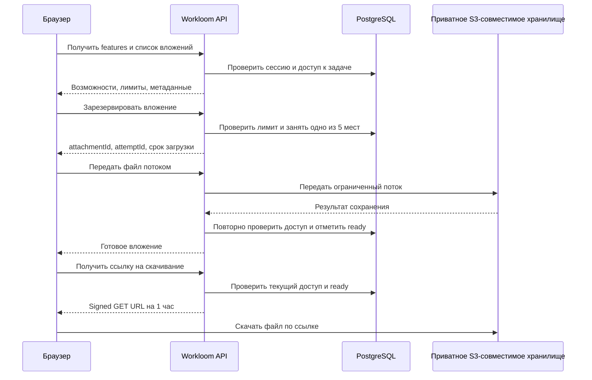

# Прикрепление файлов к задачам: исследование и предлагаемый дизайн

Дата: 27 октября 2026 года. Исторический документ исследования, предшествовавший реализации. В рамках самого исследования код и окружение не изменялись. Фактическая реализация, отличия от предложения, настройка и проверки описаны в [130](130-task-attachments.md). Ниже сохранён исходный дизайн.

Согласованный путь загрузки: **браузер → API Workloom → приватное объектное хранилище**. Байты проходят через наш API потоком. Подключение — через S3-совместимый API любого выбранного провайдера, с AWS SDK v3 и `@aws-sdk/s3-request-presigner`. Google Cloud Storage — один из возможных провайдеров. Метаданные и состояние загрузки хранятся в PostgreSQL; после проверки сессии и доступа к задаче API выдаёт signed GET URL. С учётом предложения пользователя о 1–2 часах рекомендуемый срок ссылки — **1 час по умолчанию**, с серверной настройкой до 2 часов. В интерфейсе задачи — блок вложений и кнопка «Прикрепить файл»; сервер сообщает доступность функции и её лимиты.

Потоковая передача позволяет строго контролировать объём входящих данных. Прямая загрузка из браузера в хранилище исключена по уточнению пользователя. Основная сложность — согласованность базы и хранилища при обрывах, повторах и удалении задачи; увеличение срока download-ссылки не меняет upload-протокол.

## 1. Требования и принятые решения

| Пункт | Решение |
| --- | --- |
| Количество | Максимум **5 файлов на задачу**. Пользователь подтвердил этот лимит. |
| Размер | Максимум **50 МБ на каждый файл**, а не на все вложения вместе. Пользователь подтвердил. Предлагаем точное значение `50_000_000` байт; 50 MiB — другое значение, `52_428_800` байт. |
| Авторизация | Для списка вложений, загрузки, удаления и получения ссылки требуется авторизация Workloom и доступ к конкретной задаче. |
| Временная ссылка | Пользователь допускает открытие переданной ссылки без сессии и предложил увеличить срок до 1–2 часов. Рекомендация: 3600 секунд по умолчанию, серверная настройка в пределах 60–7200 секунд. |
| Хранилище | Приватный bucket у S3-совместимого провайдера; endpoint и credentials настраиваются на сервере. Google Cloud — частный случай. Публичного адреса файла в модели данных нет. |
| SDK | AWS SDK v3: `@aws-sdk/client-s3` для объектов и `@aws-sdk/s3-request-presigner` для ссылок. |
| Загрузка | Только через API Workloom. Прямые browser-to-storage upload-ссылки не выдаются. |
| Доступность функции | Сервер сообщает конфигурационную доступность. Без настроенного хранилища кнопка заблокирована с пояснением. |
| Принадлежность | Файлы принадлежат канонической задаче, включая её отображение в нескольких проектах. У подзадачи собственный лимит. |
| Первый выпуск | Прикрепление, список, скачивание, удаление, прогресс и повтор после ошибки. Предпросмотр, версии пользовательских файлов, редактирование и перенос вложений между задачами — последующие возможности. |

Одновременно загружаемые файлы уже занимают места из пяти. Иначе две вкладки смогут превысить лимит. Максимум готовых файлов задачи составляет 250 МБ; временные объекты, резервные копии и версии объектов могут занимать дополнительное место.

## 2. Что уже есть в проекте

Исследование выполнено по текущим исходникам, без подключения к production или облачному хранилищу.

| Область | Что найдено и как использовать |
| --- | --- |
| Панель задачи | [TaskDrawer.tsx](../apps/web/src/features/tasks/TaskDrawer.tsx) — точка подключения блока вложений рядом с описанием и обсуждением. |
| HTTP и identity | [task-comments-routes.ts](../apps/api/src/http/task-comments-routes.ts) показывает существующий маршрут задачи, получение actor из сессии и общий формат ответов. |
| Права | [capabilities.ts](../packages/domain/src/access/capabilities.ts) содержит `task.read` и `task.edit`. У viewer есть чтение, у member — также редактирование. Одной роли workspace недостаточно: нужна проверка самой задачи. |
| Проверки задачи | [task-comments/service.ts](../packages/domain/src/task-comments/service.ts) проверяет текущий доступ до воспроизведения idempotency receipt; для записи учитывает архив задачи и её основного проекта. Этот путь сейчас допускает только `visibility = workspace`; вложения не должны случайно открыть неподдерживаемые private-задачи. |
| Транзакции | [workspace-write.ts](../packages/db/src/transactions/workspace-write.ts) даёт общий барьер записи workspace. Сетевые операции с хранилищем следует выполнять вне этой транзакции. |
| Планирование | [planning/ports.ts](../packages/domain/src/planning/ports.ts) и [planning/freeze.ts](../packages/domain/src/planning/freeze.ts) требуют типизированного намерения новой операции. Для вложений нужен отдельный intent, не влияющий на оценки, baseline и cutoff. |
| Размер HTTP-запросов | В [app.ts](../apps/api/src/app.ts) основной `bodyLimit` равен **16 KiB**. Нужен отдельный потоковый маршрут с собственными ограничениями; глобальное увеличение лимита было бы лишним. |
| Защита запросов | Сохраняются [request-guards.ts](../apps/api/src/http/request-guards.ts). В [security-headers.ts](../apps/api/src/http/security-headers.ts) действуют `connect-src 'self'` и `form-action 'self'`; выбранная загрузка через наш API не требует разрешать storage origin в CSP. |
| Окончательное удаление | [purge/application.ts](../packages/db/src/purge/application.ts) удаляет зависимые записи через обход FK. Это само по себе не удалит объекты хранилища. См. [документ 126](126-permanent-delete.md). |
| Эксплуатация | [Railway + Cloudflare](124-railway-cloudflare-deploy.md) описывает отдельный API и PostgreSQL. Нельзя рассчитывать на запущенный фоновый worker: обработку файловых заданий нужно явно включить в будущий deployment. |

Готовой подсистемы вложений, S3-конфигурации и контрактов файлов в проверенных API/domain/contracts не найдено. Локальный импорт Asana решает другую задачу и не заменяет файловое хранилище.

## 3. API-загрузка и единый S3-клиент

Загрузка всегда проходит через API. Браузер отправляет один бинарный поток, сервер считает реальные байты и пересылает их в хранилище с ограниченным буфером. API несёт upload-трафик; нужны backpressure, ограничения параллелизма и проверка тайм-аутов. При ограничениях инфраструктуры исправляем серверный транспорт или вводим возобновляемую загрузку через API.

По уточнению пользователя используем **AWS SDK и S3-совместимый протокол** независимо от облачного провайдера:

| Пакет | Назначение |
| --- | --- |
| `@aws-sdk/client-s3` | `S3Client`, операции PutObject, HeadObject, GetObject и DeleteObject |
| `@aws-sdk/s3-request-presigner` | `getSignedUrl(s3Client, new GetObjectCommand(...), { expiresIn })` для download-ссылок |
| `@aws-sdk/lib-storage` | Только если прототип подтвердит необходимость серверного multipart upload; размер частей, параллелизм и отмена ограничиваются явно |

Речь об **AWS SDK for JavaScript v3**: npm-пакет с буквальным именем `aws-sdk` относится к v2, поддержка которого завершилась 8 сентября 2025 года. `@aws-sdk/s3-request-presigner` используется с v3-клиентом `@aws-sdk/client-s3`; пакеты устанавливаются только при реализации. [AWS: статус v2](https://docs.aws.amazon.com/AWSJavaScriptSDK/latest/), [AWS: presigner v3](https://docs.aws.amazon.com/AWSJavaScriptSDK/v3/latest/Package/-aws-sdk-s3-request-presigner/), [AWS: multipart в v3](https://docs.aws.amazon.com/sdk-for-javascript/v3/developer-guide/migrate-s3.html).

За небольшим серверным интерфейсом скрываются запись потока, чтение метаданных, удаление объекта и выпуск download URL. Для смены совместимого провайдера меняются endpoint, region, bucket, credentials и при необходимости path-style addressing; UI, доменные правила и маршруты Workloom остаются общими. Отдельные native SDK провайдеров в выбранную архитектуру не входят.

Совместимость проверяется для реально используемого набора операций: потоковый PutObject, HeadObject, DeleteObject и presigned GetObject. Для конкретного endpoint нужно подтвердить Signature V4, формат адресации, обработку размера и checksum, поддержку используемого chunked/multipart-транспорта и заголовков скачивания. Необязательные возможности вроде version ID и conditional writes не считаются универсальными. «S3-совместимый» не означает поддержку всех расширений Amazon S3.

Google Cloud Storage — пример такой конфигурации: его XML API поддерживает взаимодействие с некоторыми S3-инструментами через `https://storage.googleapis.com` и HMAC credentials. При выборе GCS используется тот же AWS SDK-клиент, с проверкой нужных операций на этом endpoint. Service-account JSON и IAM signBlob не являются общим способом подключения в этом дизайне. [Google: interoperability](https://docs.cloud.google.com/storage/docs/interoperability).

Для 50 МБ отдельный клиентский resumable-протокол в первом выпуске не требуется: после обрыва файл можно отправить заново. Если используется S3 Multipart Upload, его upload ID остаётся на сервере; отмена и очистка учитывают незавершённые части. Клиент никогда не получает прямое разрешение на запись в bucket.

Перед реализацией нужен прототип AWS SDK на тестовом S3-совместимом endpoint: поток 50 МБ с ограниченной памятью, отмена, checksum, повтор/неизменяемость объекта, скачивание по подписанной ссылке и работа через reverse proxy. Проверка проводится для каждого заявленного поддерживаемого deployment-провайдера.

## 4. Общая схема



Объект хранилища и запись PostgreSQL нельзя сохранить одной общей транзакцией. Поэтому «файл прикреплён» означает **успешное сохранение объекта и подтверждённое состояние `ready` в базе**, а не просто завершение браузерного upload.

## 5. Предлагаемый API

Все пути ниже — предложение, а не существующие endpoints. Префикс `T` означает `/api/v1/workspaces/:workspaceId/tasks/:taskId`. Ответы используют текущий envelope Workloom; JSON-примеры ниже показывают только полезную нагрузку.

| Метод и путь | Назначение |
| --- | --- |
| `GET /api/v1/features` | Получить доступные серверные возможности и лимиты после входа |
| `GET T/attachments` | Метаданные файлов, занятые/свободные места и разрешённые действия для этой задачи |
| `POST T/attachments` | Зарезервировать место: `fileName`, `sizeBytes`, необязательный заявленный `mediaType`; `Idempotency-Key` обязателен |
| `PUT T/attachments/:attachmentId/content` | Один бинарный файл, `Content-Type: application/octet-stream`, привязка к выданному `attemptId`; сервер сохраняет и финализирует |
| `GET T/attachments/:attachmentId` | Узнать состояние после обрыва или потерянного ответа |
| `POST T/attachments/:attachmentId/download-url` | Проверить доступ и вернуть новую ссылку `{ url, expiresAt }` для `ready` |
| `DELETE T/attachments/:attachmentId` | Отменить незавершённую загрузку либо убрать готовое вложение; revision/idempotency по существующим соглашениям проекта |

`POST /attachments` возвращает идентификаторы, состояние `pending`, revision и `uploadExpiresAt`. Рекомендуемое время на начало и завершение одной попытки — до 15 минут; это предложение, подлежащее проверке тайм-аутов инфраструктуры. Клиентский `/complete` для потокового варианта не требуется.

Протокол не принимает от клиента `bucket`, `objectKey`, произвольный URL или авторство. Путь хранилища и uploadedBy определяет сервер. `attemptId` — идентификатор попытки, который сам по себе не даёт право загрузки: нужны текущая сессия, тот же actor и та же задача. При смене аккаунта UI отменяет свой upload; сервер также проверяет привязку, а не полагается на интерфейс.

Для повторов:

- Повтор резервирования с тем же ключом и тем же payload возвращает тот же attachment; изменённый payload даёт конфликт.
- Параллельный `PUT` в уже выполняющуюся попытку не запускает второй поток. Истёкшая или завершённая попытка не может перезаписать объект.
- Если ответ `PUT` потерян, клиент сначала читает состояние. При `ready` повторной загрузки нет; при `uploading` ждёт завершения или отказа; после `failed/expired` создаёт новую попытку через новое резервирование.
- Текущие права проверяются **до** любого ответа из idempotency receipt. Старый receipt не возвращает доступ исключённому участнику.
- Signed URL не сохраняется в receipt: она выпускается заново только после актуальной проверки прав.

Ошибки должны различать отсутствие сессии (`401`), отсутствие доступной задачи/вложения (`404`), запрет редактирования видимой задачи (`403`), занятые пять мест/неактуальную попытку (`409`), превышение размера (`413`), неподдерживаемый транспортный формат (`415`), ограничение частоты (`429`) и недоступность хранилища (`503`). Причины передаются стабильными кодами и локализуются клиентом; ответы не содержат credentials хранилища, signed query string или внутренний текст ошибок провайдера.

## 6. Features и отключённая кнопка

Предлагаем отдельный общий endpoint возможностей, чтобы позже добавлять другие необязательные функции:

```json
{
  "features": {
    "taskAttachments": {
      "enabled": true,
      "reason": null,
      "limits": {
        "maxFilesPerTask": 5,
        "maxFileSizeBytes": 50000000
      },
      "uploadMode": "api-stream",
      "downloadMode": "signed-url",
      "downloadUrlTtlSeconds": 3600
    }
  }
}
```

Здесь `enabled` означает, что сервер настроен для файловой функциональности. При отсутствии конфигурации: `enabled: false`, `reason: "storage_not_configured"`. Для неполной/некорректной конфигурации — `storage_configuration_invalid`. Клиент получает только безопасный код причины, без названий секретов, bucket и внутреннего endpoint.

Наличие credentials ещё не означает готовность функции. Нужны корректные endpoint/region/bucket, доступный credential provider и права на используемые object operations. Сервер создаёт один согласованно настроенный `S3Client`; для подписи используется этот же клиент и `@aws-sdk/s3-request-presigner`. Успешное локальное создание URL не доказывает доступность объекта или правильность policy: скачивание по ней проверяется отдельной интеграционной проверкой. Для внешнего S3-совместимого сервиса credentials обычно являются его access key/secret key; для AWS допустим стандартный credential provider chain. [AWS: credentials в Node.js](https://docs.aws.amazon.com/sdk-for-javascript/v3/developer-guide/setting-credentials-node.html).

`features` не должен делать сетевой запрос к хранилищу при каждом открытии страницы или блокировать `/me`. Конфигурацию проверяем локально, работоспособность — отдельной эксплуатационной проверкой и результатами реальных операций. `enabled: true` не гарантирует отсутствие временного сбоя: в этом случае upload/download возвращает `503`, а UI предлагает повтор. Сбой необязательного хранилища не должен мешать входу и работе с текстовыми задачами.

Серверная возможность не заменяет права пользователя. Ответ списка вложений отдельно содержит `canUpload`, `canDelete` и доступное число мест с учётом роли, состояния задачи и текущих загрузок. Все ограничения повторно применяются на mutation endpoints; изменённый JavaScript в браузере ничего не обходит.

При выключенной функции кнопка остаётся видимой. Пояснение: **«Чтобы прикреплять файлы, настройте файловое хранилище на сервере»**. Tooltip должен открываться при наведении и с клавиатуры; у нативной disabled-кнопки для этого понадобится доступная обёртка. Для viewer, архива или заполненного лимита показывается соответствующая причина, а не сообщение о настройке сервера. Сбой запроса `features` отображается как временная невозможность проверить функцию с повтором, без ложного утверждения об отсутствии конфигурации.

Существующие метаданные вложений не исчезают при отключении хранилища. Если хранилище недоступно, скачивание получает отдельное понятное состояние. Если в будущем добавляется аварийное отключение только загрузки, его нужно моделировать отдельно от чтения, чтобы не блокировать старые файлы.

## 7. Данные, лимит и согласованность

Для вложений нужна **отдельная реляционная таблица**, а не массив JSONB в задаче. Пять конкурентных загрузок, состояния, удаления и индексы проще и надёжнее выразить обычными колонками и ограничениями. JSONB допустим для необязательных служебных метаданных; сами файлы в PostgreSQL не храним.

Предлагаемые сущности:

| Сущность | Основные поля |
| --- | --- |
| `task_attachments` | `id`, `workspace_id`, `task_id`, `uploaded_by_user_id`, исходное безопасное имя, заявленный/фактический размер, заявленный/определённый MIME, `state`, `slot`, `revision`, даты создания/готовности/удаления, текущая попытка |
| `attachment_upload_attempts` | `id`, attachment/workspace/task/actor binding, сгенерированный storage key, идентификатор настроенного хранилища, `expires_at`, generation/lease, результат сохранения, checksum, необязательный `version_id`, если выбранный endpoint предоставляет его через S3 API |
| `storage_cleanup_jobs` | Точный storage target/key/version, причина удаления, время исполнения, счётчик повторов, lease и результат; запись переживает удаление задачи/проекта |

Список для UI не раскрывает storage key, bucket, credentials, checksum внутреннего контроля или signed URL. Показываются id, имя, размер, автор, дата, состояние и допустимые действия. Историю неудачных попыток не нужно выдавать всем читателям задачи: достаточно активных вложений и восстановления собственной загрузки.

Состояния: `pending → uploading → ready`; альтернативные завершения — `failed`, `expired`, `deleted`. Если позже появится проверка антивирусом, между uploading и ready добавляется закрытое для скачивания состояние `checking`, а не отметка «проверен» без реальной проверки.

Лимит защищается в короткой транзакции под существующим workspace write barrier: проверить текущие права, актуальное состояние задачи, занятые места, затем зарезервировать свободный `slot` от 1 до 5. Дополнительная защита БД — CHECK для диапазона и частичный UNIQUE `(workspace_id, task_id, slot)` для `pending/uploading/ready`. FK связывает workspace и task совместно, чтобы вложение нельзя было привязать к чужой задаче. Истечение времени переводит состояние явно; динамическое условие с `now()` в индексе не используется.

Последовательность записи:

1. Транзакция резервирует слот и попытку. Путь будущего объекта записан **до** сетевой операции — потерянный процесс не оставляет объект без известного владельца.
2. `PUT` проверяет сессию, actor binding и состояние; атомарно получает право выполнить эту попытку. Никаких запросов к хранилищу под длительной блокировкой workspace.
3. Сервер считает фактические байты, ограничивает поток 50 000 000 байтами и проверяет совпадение с заявленным размером. При превышении, обрыве, тайм-ауте или отмене прерывает передачу в хранилище. Заголовок `Content-Length` и клиентский `file.size` не заменяют этот счётчик.
4. После успешного ответа хранилища сервер повторно проверяет действительность авторизации, доступ, архив, состояние и generation попытки. Только затем фиксирует `ready`, размер и контрольные данные.
5. Если доступ отозван, задача удалена, попытка истекла или фиксация не состоялась, файл не становится видимым. Сохранённый объект подлежит повторяемой очистке.

Каждая новая попытка получает новый непредсказуемый key, например `attachments/<workspace-uuid>/<attachment-uuid>/<attempt-uuid>`. Имя пользователя не включается в key. Готовый объект неизменяем: новая попытка не пишет по его пути. Базовая защита общая для провайдеров: уникальный key, единственный владелец попытки в БД, отсутствие клиентского права записи и запрет повторного upload после `ready`. Для повторов SDK отдельно проверяется, что они не могут перезаписать завершённую попытку. Если провайдер поддерживает условный PutObject, дополнительно применять `If-None-Match: *`; его поддержку нельзя предполагать для любого совместимого endpoint. [AWS: conditional writes](https://docs.aws.amazon.com/AmazonS3/latest/userguide/conditional-writes.html). При доступном через S3 API version ID сохраняем его и используем для чтения/удаления. Provider-specific generation/preconditions не входят в обязательный общий контракт.

При неоднозначном сетевом исходе нельзя превращать результат `HEAD: объект существует` в автоматическое `ready`. Нужны совпадение попытки, фактического размера и подтверждённой целостности, а также новая проверка прав. Без достаточных доказательств объект очищается, пользователь повторяет загрузку. `ETag` не принимается за универсальный SHA-256/MD5 файла; checksum выбирается и проверяется явно. [AWS: проверка целостности загрузки](https://docs.aws.amazon.com/AmazonS3/latest/userguide/checking-object-integrity-upload.html).

Позднее завершение старого upload после очистки не должно «воскресить» вложение. Generation/lease блокирует финализацию, а задача очистки сохраняется до завершения окна возможной записи и повторно проверяет точный key. Одноразового `DeleteObject` сразу после отмены недостаточно: ещё работающий upload может закончиться позже. При purge сведения об открытых попытках переносятся в независимые cleanup jobs в той же транзакции.

## 8. Авторизация и скачивание

Права первой версии предлагается наследовать от задачи:

| Действие | Проверка |
| --- | --- |
| Список и получение ссылки | Текущая сессия, активное членство, `task.read`, доступ к самой задаче, attachment принадлежит этой задаче/workspace |
| Резервирование, upload и финализация | Те же проверки + `task.edit`, задача и основной проект не архивированы, попытка принадлежит текущему actor |
| Удаление готового файла | `task.edit` и доступ к активной задаче; в первой версии редакторы задачи могут удалять её вложения независимо от автора |
| Отмена своей незавершённой попытки | Актуальный доступ и binding автора; серверная очистка истёкших попыток не зависит от сохранения доступа автора |

Архивация задачи сохраняет файлы для чтения и последующего восстановления. Удаление отдельного размещения связанной задачи в другом проекте не удаляет вложения канонической задачи. При создании независимой копии/продолжения задачи первая версия не копирует файлы автоматически; это отдельная будущая операция с явной семантикой и квотой.

Signed URL — временное разрешение на конкретный объект. Хранилище не проверяет cookie Workloom; любой обладатель ссылки может использовать её в течение срока действия. Отзыв роли прекращает выдачу новых ссылок, но сам по себе не аннулирует уже выданную. Для AWS срок может дополнительно ограничиваться временем жизни credentials и bucket policy; для других совместимых endpoint ограничения проверяются при подключении. [AWS: presigned URLs](https://docs.aws.amazon.com/AmazonS3/latest/userguide/using-presigned-url.html).

Рекомендация: **1 час по умолчанию**, настраиваемый TTL от 60 секунд до 2 часов. Это удобный запас для повторного открытия и возобновления запроса; цена — такое же окно доступа по скопированной ссылке после отзыва прав в Workloom. Два часа тоже допустимы, если это окно устраивает владельца данных; необходимости делать их обязательным минимумом нет. Ранее предложенные 1–2 минуты заменены этой рекомендацией. Значение выбирает сервер, а не клиент; `expiresAt` возвращает фактический срок действия с учётом ограничений выбранного механизма подписи. Для чтения через API со строгой сессией действует отдельный вариант ниже.

Выпускать ссылку только по действию пользователя, на один `ready`-объект. Не хранить её в БД, localStorage, аналитике или постоянном HTML; не включать в обычный список вложений. После истечения UI получает новую ссылку с повторной авторизацией. Для пересылки между участниками предпочтительна постоянная ссылка на задачу Workloom.

Ответ API со ссылкой: `Cache-Control: private, no-store`. Для объекта при сохранении задаются `Content-Disposition: attachment` с безопасно закодированным именем, `Content-Type: application/octet-stream` и `Cache-Control: private, no-store`. Если используются response overrides, они передаются в `GetObjectCommand` до подписи через `getSignedUrl`; после подписи hostname, path и query не переписываются. Поддержка заголовков и фактический ответ проверяются на выбранном endpoint. Произвольные HTTP-заголовки нельзя считать доступными через signed URL: для собственного ответа нужен API/gateway. [AWS: GetObject](https://docs.aws.amazon.com/AmazonS3/latest/API/API_GetObject.html).

Переход к хранилищу выполняется как скачивание/навигация, без загрузки всего файла через браузерный `fetch` в память. Для такого перехода браузерный CORS не нужен. Если позже появятся JS-предпросмотр, потребуется отдельная CORS/CSP-настройка. CORS не заменяет авторизацию.

Если требование изменится на «даже переданная ссылка работает только с текущей сессией», нужен другой режим: API проверяет доступ и **сам передаёт байты скачивания**, включая проверки для Range-запросов; redirect на хранилище этого требования не выполняет. Для подтверждённой первой версии такой дополнительный трафик через API не требуется.

## 9. Поток, безопасность и конфигурация хранилища

В API следует добавить инкапсулированный обработчик `application/octet-stream`. Он передаёт поток с backpressure и ограниченным буфером, без `Buffer.concat`, base64 или `parseAs: 'buffer'` для всего файла. При собственном stream parser ограничения нужно реализовать явно; нельзя предполагать, что глобальный JSON `bodyLimit` автоматически защищает такой путь. Авторизация и проверка попытки выполняются до потребления большого тела. [Fastify: Content-Type Parser](https://fastify.dev/docs/latest/Reference/ContentTypeParser/).

Нужны ограничения параллельных upload на пользователя и процесс, частоты резервирований и времени без прогресса. Начальные значения следует подобрать проверкой нагрузки, а не выдавать за измеренные. Переполнение очереди возвращает `429`, а не копит неограниченные потоки. Лимит пяти файлов на задачу не ограничивает весь workspace: перед широким запуском нужна отдельная суммарная квота хранения с учётом резервирований и операционный лимит расходов.

Имена файлов — данные для отображения: ограничить длину, убрать пути, управляющие символы и CR/LF, корректно экранировать в UI и `Content-Disposition`. Заявленному MIME доверять нельзя. В первом выпуске предлагаем хранить файлы как непрозрачные вложения: не исполнять, не распаковывать, не рендерить HTML/SVG в origin Workloom. Это не антивирусная проверка. Для внешних/недоверенных участников следует отдельно выбрать политику допустимых типов и проверку в карантине перед `ready`. OWASP рекомендует комплексную проверку имён, типов, размеров и безопасное размещение файлов. [OWASP: File Upload](https://cheatsheetseries.owasp.org/cheatsheets/File_Upload_Cheat_Sheet.html).

Общая конфигурация хранилища:

| Серверный параметр | Назначение |
| --- | --- |
| `ATTACHMENTS_S3_ENDPOINT` | HTTPS endpoint выбранного провайдера; для AWS может определяться SDK по region |
| `ATTACHMENTS_S3_REGION` | Значение region для клиента и подписи, требуемое конкретным провайдером |
| `ATTACHMENTS_S3_BUCKET` | Приватный bucket |
| `ATTACHMENTS_S3_FORCE_PATH_STYLE` | Управление path-style/virtual-hosted addressing по требованиям endpoint |
| `ATTACHMENTS_SIGNED_URL_TTL_SECONDS` | По умолчанию 3600; серверная валидация в пределах 60–7200 секунд |
| Credentials | Access key ID/secret access key выбранного сервиса; optional session token там, где он поддерживается, либо AWS credential provider chain для AWS |

Точный способ передачи credentials выбирается по серверному окружению; статическая конфигурация может использовать `AWS_ACCESS_KEY_ID`, `AWS_SECRET_ACCESS_KEY`, при необходимости `AWS_SESSION_TOKEN`. Префикс AWS относится к интерфейсу SDK и не означает обязательное размещение в Amazon. Secrets не коммитятся, не попадают в браузер и ответ features. Наличие `ATTACHMENTS_STORAGE_PROVIDER=gcs` и зависимость от Google SDK не требуются. Имена параметров пока являются предложением, код не добавлен.

Bucket закрыт, credentials имеют минимальные права на необходимые object operations. Runtime не нужны права создавать bucket или менять его публичность. HTTPS, серверное шифрование и политика хранения проверяются для выбранного сервиса. Файловые ответы и ответы API не попадают в публичный CDN-кеш; signed query strings и credentials исключаются из логов, error tracking и аналитики. В audit/outbox — идентификаторы и результат операции.

Конкретные названия настроек приватности зависят от оператора хранилища. Для AWS это Block Public Access и Bucket owner enforced; для GCS — Public Access Prevention и uniform bucket-level access. Эти настройки относятся к подготовке bucket и не требуют отдельного native SDK в Workloom. [AWS: Block Public Access](https://docs.aws.amazon.com/AmazonS3/latest/userguide/access-control-block-public-access.html), [Google: public access prevention](https://docs.cloud.google.com/storage/docs/public-access-prevention), [Google: uniform bucket-level access](https://docs.cloud.google.com/storage/docs/uniform-bucket-level-access).

Endpoint выбирает оператор сервера, а не пользователь upload. В production допускается только доверенный HTTPS endpoint; локальное исключение для тестового хранилища задаётся отдельно. Endpoint, использованный для download-подписи, должен быть доступен браузеру; нельзя подписать внутренний адрес и затем заменить hostname. Если для доступа API нужен отдельный внутренний маршрут, конфигурация подписи должна явно сохранять внешний адрес и корректные параметры клиента.

При смене bucket/провайдера старые вложения должны сохранять ссылку на прежнюю конфигурацию хранения либо проходить управляемую миграцию: замена переменной окружения не переносит файлы.

Для текущей схемы Railway + Cloudflare необходимо проверить реальные лимиты и тайм-ауты всей цепочки. Документация Cloudflare указывает базовый upload limit 100 MB для Free/Pro, но оператор может уменьшить его; подходящий размер не гарантирует прохождение медленной загрузки. Это справочная граница, а не проверка настроек нашего production. [Cloudflare: upload limits](https://developers.cloudflare.com/cache/concepts/default-cache-behavior/).

## 10. Удаление и эксплуатация

Удаление вложения сначала атомарно скрывает его в БД и записывает durable cleanup job. Новые ссылки больше не выдаются; место в задаче освобождается. Удаление из хранилища выполняется с повторами. Ранее выданная ссылка может работать до удаления объекта или истечения её срока — UI не должен обещать мгновенный отзыв уже скачанных данных.

При окончательном удалении задачи или проекта нужно **до удаления зависимых записей** собрать точные storage keys/versions и незавершённые попытки, затем сохранить задания очистки в той же транзакции purge. Очередь не должна исчезать вместе с FK-замыканием задачи, проекта или workspace. Только после commit выполняются запросы к хранилищу. Обычная архивация/Undo не запускает физическое удаление файлов.

Нужен явно запущенный maintenance runner: истечение резервирований, восстановление незавершённых операций, retry удаления и учёт незавершённых upload-сессий выбранного провайдера. Его можно оформить отдельной командой и запускать по расписанию, например раз в пять минут, с lease в БД для нескольких экземпляров. Это новая часть будущего deployment; существующий recurrence worker не требуется включать целиком. Кнопка «Удалить» и запись в outbox без работающего обработчика недостаточны.

Runner действует только по известным объектам и проверенному prefix. Массовое удаление всех «не найденных в таблице» объектов без учёта активных попыток, восстановления БД и параллельных операций недопустимо. Lifecycle/очистка незавершённых upload-сессий, если поддерживаются выбранным провайдером, — дополнительная страховка, а не замена прикладной очистке и разрешению гонок.

Для каждого провайдера согласовать versioning, retention и soft delete. Например, в versioned AWS S3 обычный DeleteObject создаёт delete marker, а окончательное удаление требует конкретных version ID. У поддерживающих soft delete GCS bucket стандартное окно сохранения удалённых объектов — 7 дней; настройки конкретного bucket нужно проверить. Удаление из Workloom и прекращение обычного скачивания не означают немедленное физическое стирание всех копий. Эти различия отражаются в эксплуатационной политике выбранного endpoint. [AWS: удаление версий объектов](https://docs.aws.amazon.com/AmazonS3/latest/userguide/DeletingObjectVersions.html), [Google: soft delete](https://docs.cloud.google.com/storage/docs/soft-delete).

Резервная копия PostgreSQL сама по себе не резервирует содержимое объектного хранилища. До выпуска нужно определить срок хранения объектов/версий, поведение после restore базы и очистку с учётом выбранного окна восстановления. Метрики: возраст старейшего cleanup job, просроченные uploads, ошибки/длительность storage-операций, число и объём ready/pending объектов. Метрики и диагностика не раскрывают имена и содержимое файлов.

Настройка инфраструктуры потребуется один раз со стороны владельца серверного окружения: bucket/policy, credentials, переменные API и расписание обслуживания. Изменение репозитория само по себе не создаёт эти ресурсы. Пока они не настроены, приложение продолжает работать с заблокированной кнопкой прикрепления.

## 11. Поведение интерфейса

Внутри задачи — «Вложения · 2/5», список файлов и кнопка прикрепления. Строка файла содержит имя, размер, автора/дату, скачивание и разрешённое удаление. У загружаемого файла — прогресс, отмена и понятная ошибка с повтором. Лимиты приходят с сервера, а не дублируются независимыми константами UI.

При выборе нескольких файлов клиент проверяет свободные места и размеры до передачи; сервер остаётся источником истины. Для каждого файла собственная попытка и результат: отказ одного не удаляет успешно прикреплённые. После `409` интерфейс обновляет список и поясняет, что свободные места изменились. Повтор не создаёт дубликат, если сервер уже закончил загрузку.

Новую задачу сначала нужно сохранить и получить её id, затем прикреплять файлы. Reload не обещает продолжить передачу байтов с прежнего места: интерфейс получает сохранённое состояние попыток и предлагает безопасный повтор после их завершения/истечения. Не сохранять содержимое файлов или signed URLs в localStorage.

В первом выпуске открытие файла запускает скачивание. Отдельный inline-предпросмотр изображений/PDF потребует дополнительных правил типов, отдельного контекста отображения и кеширования; его лучше не включать незаметно в базовую кнопку.

## 12. План реализации и критерии готовности

Порядок работ предлагается такой:

1. **Проверка транспорта на тестовом bucket.** Настроить AWS SDK v3 на выбранный S3-совместимый endpoint; проверить поток 50 МБ, ограниченную память, отмену, checksum, условную запись и выдачу ссылок. Зафиксировать точные тайм-ауты.
2. **Контракты, миграция и домен.** Добавить вложения, попытки и cleanup jobs; лимит пяти слотов, права, idempotency, отдельный planning intent и audit/outbox. Номер миграции выбрать по состоянию репозитория на момент реализации.
3. **Storage adapter и API.** Закрытая конфигурация, features, reserve/upload/status/download/delete, финализация с повторной авторизацией и обработка сбоев.
4. **Очистка и purge.** Работающий runner, гонки позднего upload, удаление проекта/задачи, политика версий/restore, диагностика. Это часть первого выпуска.
5. **UI задачи.** Disabled tooltip, права, лимиты, прогресс, отмена, повторы, скачивание и удаление; локализация и клавиатурный доступ.
6. **Проверка в инфраструктуре перед включением.** Конфигурация bucket/провайдера и proxy, реальные 50 МБ, политика доступа, расписание очистки. Включать функцию после проверки, без зависимости авторизации приложения от доступности хранилища.

Проверки, которые должны доказать реализацию:

| Сценарий | Ожидаемый результат |
| --- | --- |
| Размер ровно 50 000 000 и на байт больше | Первый допускается, второй отклоняется; проверка работает при неверном заявленном размере и потоковой передаче |
| Четыре готовых файла, две конкурентные загрузки | Только одна получает пятый слот; тот же результат для разных вкладок и API-экземпляров |
| Повтор reserve, двойной PUT, потеря ответа | Нет двойного слота, перезаписи готового файла или ложной ошибки при уже успешной загрузке |
| Нет сессии, viewer, чужая задача, чужой attachmentId | Доступ соответствует матрице прав; имена и существование чужих вложений не раскрываются |
| Отзыв роли/смена аккаунта/архивация во время upload | Новая финализация не проходит, файл очищается; старый idempotency receipt не обходит проверку |
| Сбой хранилища, разрыв клиента, перезапуск API, сбой БД после upload | Не появляется ложное ready; попытка и объект доступны процессу восстановления/очистки |
| Отмена или purge во время upload, поздний storage success | Удалённое вложение не воскресает; cleanup не теряет key и удаляет поздно появившийся объект |
| Прямой URL без подписи, ссылка до/после TTL | Публичный доступ закрыт; подписанная ссылка работает в разрешённом окне; повторный запрос ссылки проверяет текущие права |
| Отсутствующая/неполная конфигурация, временный отказ хранилища | Корректный tooltip/повтор; вход, задачи и старые метаданные продолжают работать |
| Архивация/Undo, связанная задача, независимая копия | Архив сохраняет файлы; связанные размещения используют один список; независимая копия не получает файлы неявно |
| Cleanup после рестарта, политика версий/soft delete и restore БД | Задания переживают удаление родителей; действуют согласованные правила версий и восстановления |
| Медленная загрузка и несколько параллельных файлов | Ограниченная память, управляемые тайм-ауты/параллелизм, отсутствие неограниченной очереди |

На уровне проекта нужны domain/unit проверки переходов и авторизации, PostgreSQL-тесты конкурентных слотов/purge, HTTP-тесты реального потока, UI-тесты состояний и отдельная интеграционная проверка выбранного storage-провайдера. Mock/локальный эмулятор не доказывает поведение реального IAM, подписи, CORS или reverse proxy.

Сложность оценивается как **средняя для отдельной подсистемы**: UI и выдача signed URL сравнительно просты; основная работа — согласованность загрузки, конкурентный лимит, права и надёжное удаление. Для последующей реализации остаётся выбрать deployment-провайдера с поддержкой нужных S3-операций, политику типов/антивирусной проверки, общую квоту workspace и срок восстановления объектов. Подтверждённые требования — пять файлов, 50 МБ на файл, загрузка через наш API и общий S3-клиент AWS SDK v3 с `@aws-sdk/s3-request-presigner`. Рекомендуемый TTL по последнему обсуждению — один час с серверной настройкой до двух часов.

## 13. Границы исследования

Проверены существующие точки интеграции в исходниках и официальные документы Google Cloud, AWS, Cloudflare, Fastify и OWASP, ссылки приведены рядом с соответствующими выводами. API, схемы таблиц, параметры окружения и этапы выше являются предложением. Новая миграция не создавалась; код, база и runtime не менялись. Проверка реального облачного хранилища, IAM, production-конфигурации и производительности не выполнялась. Для самого документа проверены локальные ссылки и согласованность; сборка приложения для этого не запускалась.
